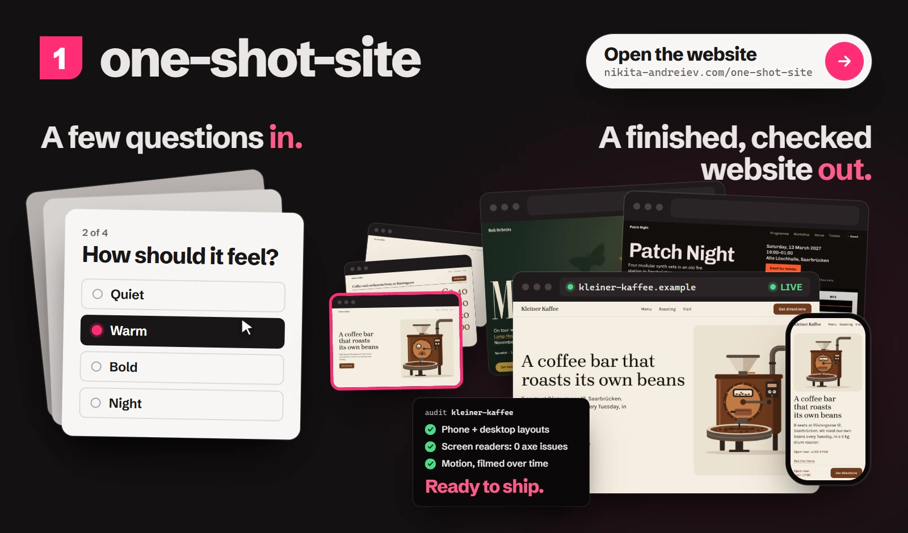
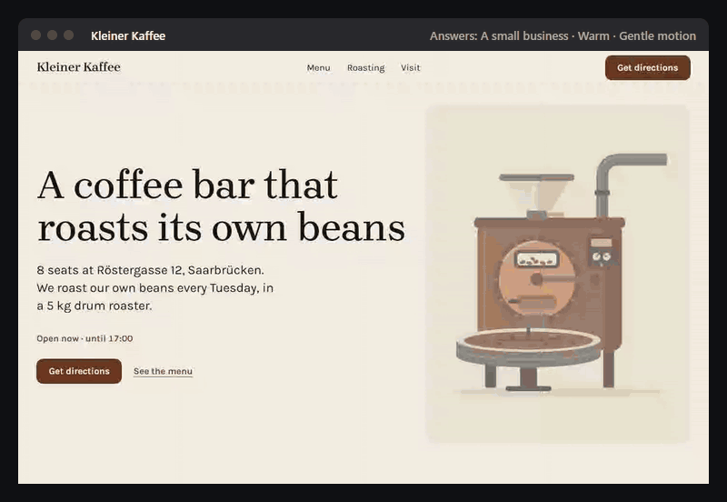
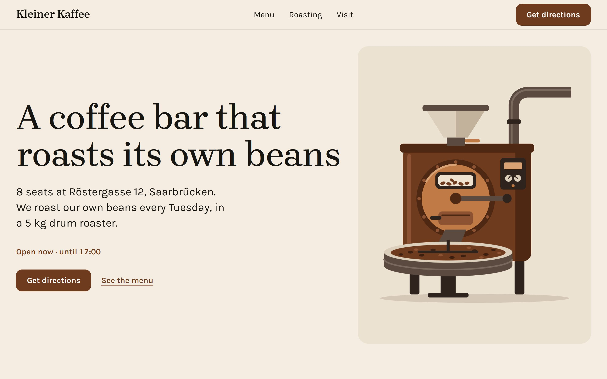
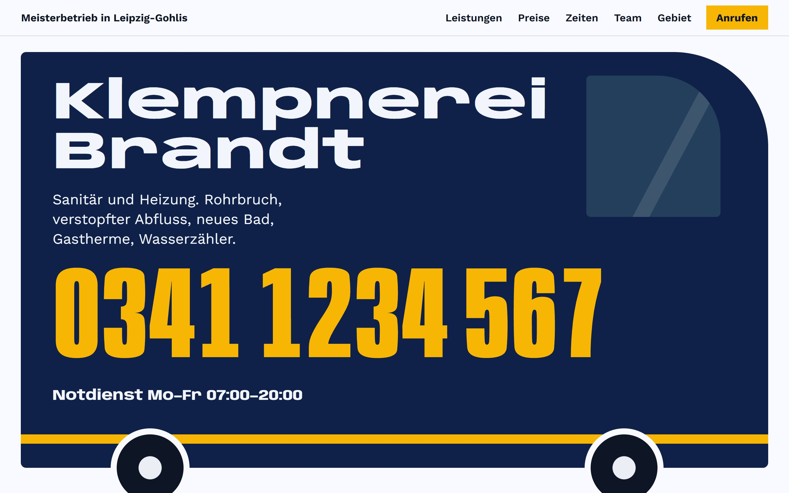
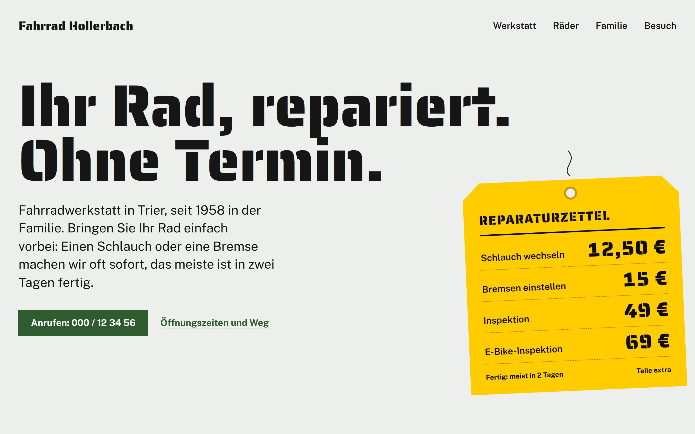
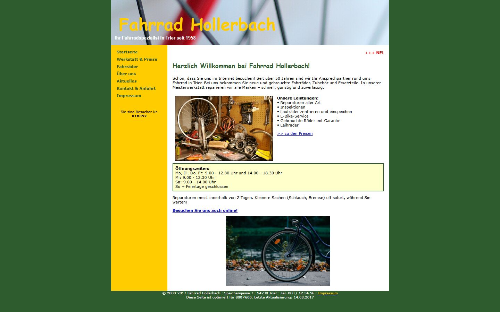
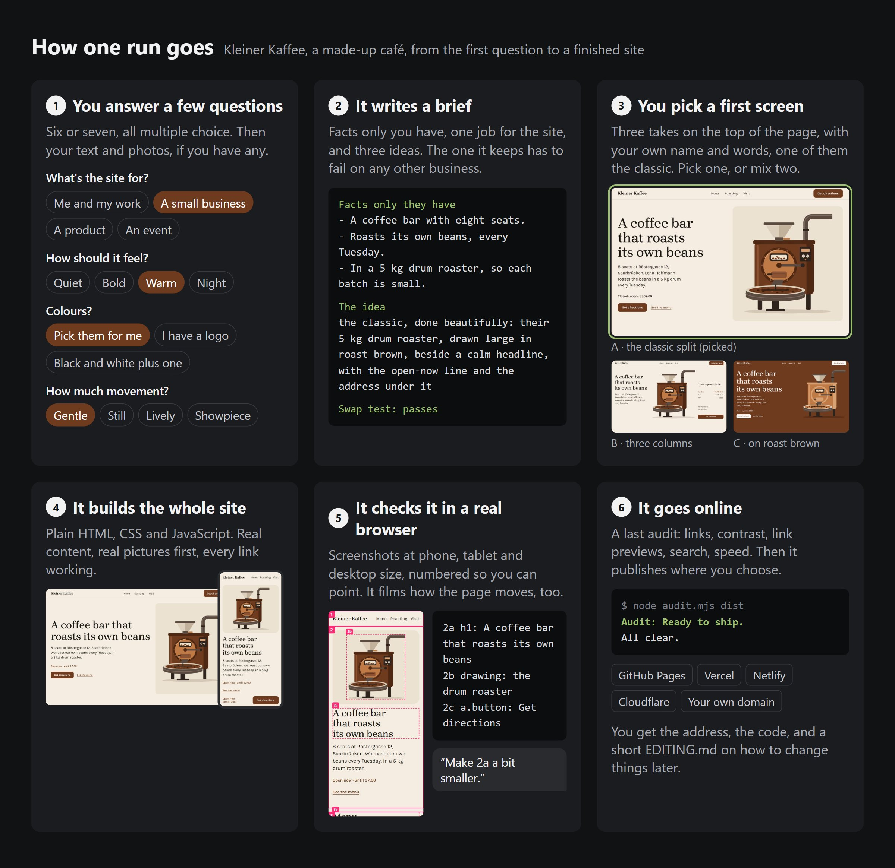
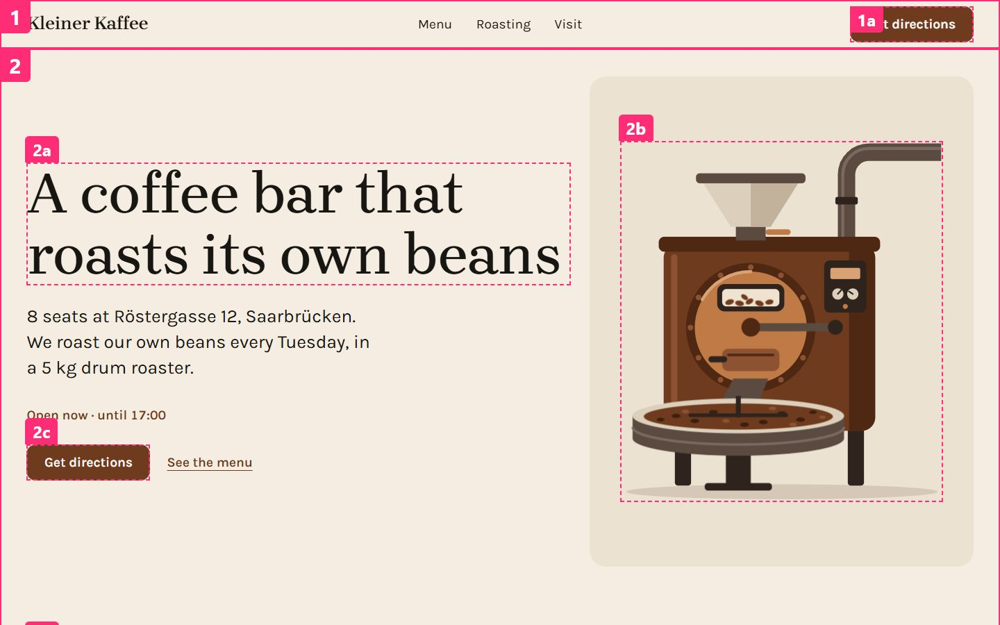
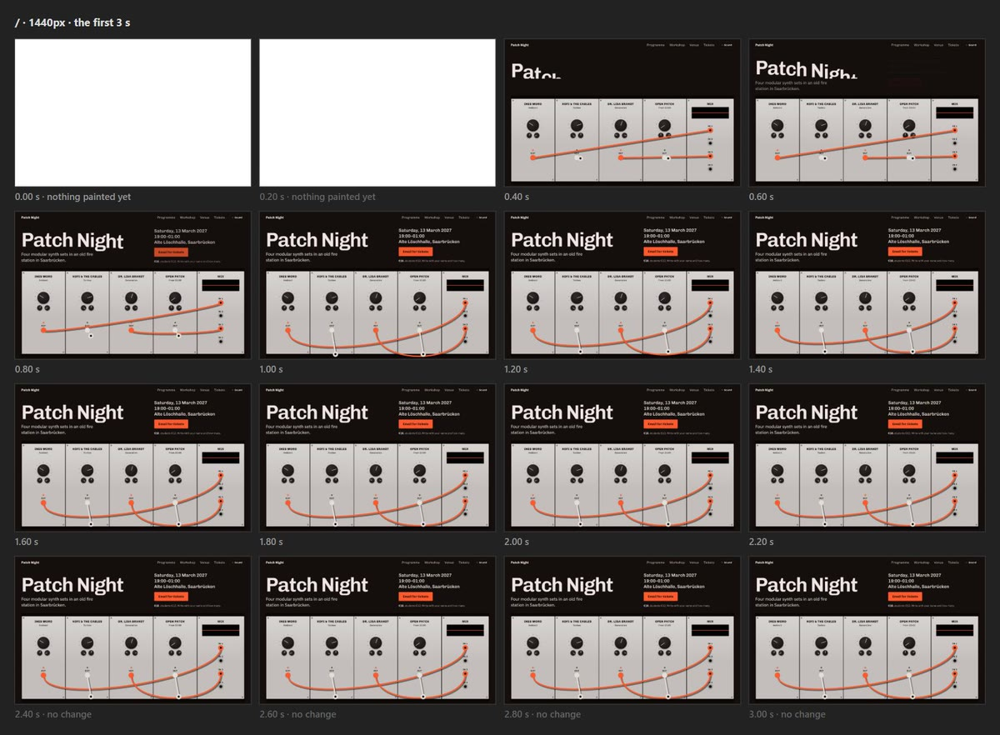
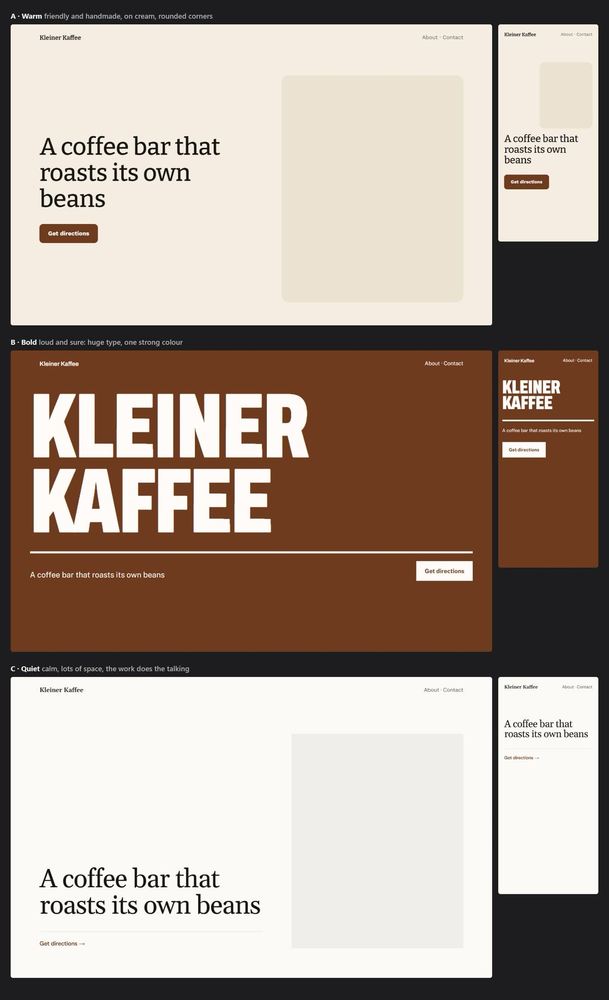

<h1 align="center">one-shot-site</h1>

<p align="center">
  <a href="https://nikita-andreiev.com/one-shot-site/"></a>
  &nbsp;
  <a href="LICENSE"></a>
  &nbsp;
  <a href="CHANGELOG.md"></a>
  &nbsp;
  <a href="#install"></a>
</p>

<p align="center">
  <a href="https://nikita-andreiev.com/one-shot-site/"></a>
</p>

<p align="center">
  <a href="https://nikita-andreiev.com/one-shot-site/"><b>Open the website →</b></a><br>
  <sub>How it works, six examples, the film and the install</sub>
</p>

**Answer a few multiple-choice questions and your agent builds the website. It opens the site in a real browser to
check it at phone and desktop size, and puts it online when you say yes.**

You answer once, hence the name.

I wanted one skill that goes all the way from the first question to a live site, without hunting for separate design
skills, checkers and deploy tools.

1. **For people who aren't designers, from the first question to the live site.** You don't need design words for
   the questions. Once you've answered, it draws a few ideas using your own name, so you can point at one instead of
   describing it, and one of them is always a classic layout. At the end it publishes the site and checks the live
   copy.
2. **Checked before it goes live.** There's an audit at the end, and the run doesn't stop until it passes. The audit
   looks at the link previews, tries every link, runs axe-core's accessibility rules and measures how much a first
   visit downloads. I also had it film the motion, because something that jumps only shows up over a few seconds. A
   German business gets an Impressum and a privacy page as well. Whatever fails gets fixed, and the audit runs again
   until it says "Ready to ship".
3. **Easy to keep up to date.** Opening hours, prices and events sit in one file. Say you're closing on Christmas
   Eve: you tell your agent "We're closed on the 24th" and it takes care of it. Each change is saved, so you can
   undo it later.

It's an agent skill. I build and test it in Claude Code, and since it uses the open
[Agent Skills](https://agentskills.io) format, Codex, Cursor and other agents can load it too.



<sub>Each site came from one run, with the answers that made it in its title bar. The businesses are made up.</sub>

## Try it

1. Install it: `npx skills add Barabosik/one-shot-site -g -a claude-code` (`-a codex` or `-a cursor` for those, or
   see [other ways](#install))
2. Open your agent in an empty folder (restart it if it was already open).
3. Say **"make me a website"**.

First come six or seven multiple-choice questions, and then it asks for any text and photos you have. You pick from
three ideas and then from three first screens. After that it builds the whole site, checks it in a browser at phone
and desktop size, and puts it online wherever you choose. At no point do you need to know a hex code or a font name.

A whole site takes up to two hours of agent time, and often less than one. After that you can ask for changes in
your own words, for example:

- *"make it calmer"*
- *"another idea for the menu"*
- *"new hours from 1 November"*
- *"redesign my site"*, with the link to the old one
- *"publish it"*

## What you get

- It makes a static site of plain HTML, CSS and JavaScript with no framework. The files are yours, and nothing costs
  money each month.
- By default the look is calm. The background stays light, your colour goes on the buttons rather than everywhere,
  and your name doesn't get effects. If you pick Bold or Night, you get those looks instead.
- It uses your own photos where it can. Otherwise it looks for free ones you're allowed to use and credits them
  properly, or finds old pictures of your town. It only draws when nothing usable turns up or you don't want photos.
- Before anything ships it checks the phone layout, contrast (on photos too), accessibility, link previews, search,
  speed and dead links.
- The tests cover two ways to hand the site over, publishing to GitHub Pages or giving you the folder. It can also
  publish to Vercel, Netlify or Cloudflare, or use your own domain.
- Give it the link to a site you like and it measures the colours, type, spacing and motion there. It copies how
  that site feels and none of its content.
- Motion gets filmed while the page loads and scrolls, which is how jumps and endless loops get caught.
- The screenshots it shows you are numbered, so "make 2a bigger" is enough to change one part.
- Search engines and Google Maps get the address and opening hours in a form they can read. If you say the business
  is in Germany or Austria, you also get an Impressum and a privacy page to fill in.

## Made with it

These sites came from six runs for made-up clients. A run started from the answers under the picture plus a few
lines about the business. Click a picture to open that site live.

<!-- The pictures open the examples at https://nikita-andreiev.com/one-shot-site/<name>/, where docs/build.mjs
     puts them. If the project page moves, that address is the one string to replace, here and in examples/. -->

<table>
  <tr>
    <td align="center" width="50%"><a href="https://nikita-andreiev.com/one-shot-site/kleiner-kaffee/"></a></td>
    <td align="center" width="50%"><a href="https://nikita-andreiev.com/one-shot-site/klempnerei-brandt/"></a></td>
  </tr>
  <tr>
    <td align="center"><b>Kleiner Kaffee</b><br>Warm&nbsp;· Gentle&nbsp;motion<br><a href="https://nikita-andreiev.com/one-shot-site/#run-kleiner-kaffee">See&nbsp;the&nbsp;run</a>&nbsp;· <a href="examples/kleiner-kaffee">Source</a></td>
    <td align="center"><b>Klempnerei Brandt</b><br>Bold&nbsp;· No&nbsp;motion&nbsp;· In&nbsp;German<br><a href="https://nikita-andreiev.com/one-shot-site/#run-klempnerei-brandt">See&nbsp;the&nbsp;run</a>&nbsp;· <a href="examples/klempnerei-brandt">Source</a></td>
  </tr>
  <tr>
    <td align="center" width="50%"><a href="https://nikita-andreiev.com/one-shot-site/moth-orchestra/"></a></td>
    <td align="center" width="50%"><a href="https://nikita-andreiev.com/one-shot-site/jonas-weber/"></a></td>
  </tr>
  <tr>
    <td align="center"><b>Moth Orchestra</b><br>Night&nbsp;· Showpiece&nbsp;· Sound<br><a href="https://nikita-andreiev.com/one-shot-site/#run-moth-orchestra">See&nbsp;the&nbsp;run</a>&nbsp;· <a href="examples/moth-orchestra">Source</a></td>
    <td align="center"><b>Jonas Weber</b><br>Bold&nbsp;· Lively&nbsp;· Light&nbsp;and&nbsp;dark<br><a href="https://nikita-andreiev.com/one-shot-site/#run-jonas-weber">See&nbsp;the&nbsp;run</a>&nbsp;· <a href="examples/jonas-weber">Source</a></td>
  </tr>
  <tr>
    <td align="center" width="50%"><a href="https://nikita-andreiev.com/one-shot-site/fahrrad-hollerbach/"></a></td>
    <td align="center" width="50%"><a href="https://nikita-andreiev.com/one-shot-site/patch-night/"></a></td>
  </tr>
  <tr>
    <td align="center"><b>Fahrrad Hollerbach</b><br>A&nbsp;redesign&nbsp;· Gentle&nbsp;motion<br><a href="https://nikita-andreiev.com/one-shot-site/#run-fahrrad-hollerbach">See&nbsp;the&nbsp;run</a>&nbsp;· <a href="examples/fahrrad-hollerbach">Source</a></td>
    <td align="center"><b>Patch Night</b><br>Night&nbsp;· Showpiece&nbsp;· Sound<br><a href="https://nikita-andreiev.com/one-shot-site/#run-patch-night">See&nbsp;the&nbsp;run</a>&nbsp;· <a href="examples/patch-night">Source</a></td>
  </tr>
</table>

In [examples/](examples) there's every answer, the phone views, the brief and the full source, plus the small fixes
made after the runs.

## Already have a site?

Say *"Redesign my site"* and give the link. It reads the old site first, with the text of every page, your photos,
opening hours and contact details, and takes a picture of each page. It asks only about the look, and sends back the
facts it found for you to confirm in one go. The new site keeps all of it, or the brief says why something goes, and
it keeps what people know you by, such as the name, the logo or a colour. At the end you see each old page next to
the new one, at desktop and phone size. Use this for a site that is yours. A site you only like gives its feel,
never its words or photos.

| Before | After |
|---|---|
| <a href="examples/fahrrad-hollerbach"></a> | <a href="https://nikita-andreiev.com/one-shot-site/fahrrad-hollerbach/"></a><br><a href="https://nikita-andreiev.com/one-shot-site/fahrrad-hollerbach/">Open the live site →</a> · <a href="https://nikita-andreiev.com/one-shot-site/#run-fahrrad-hollerbach">See the run</a> |

*Fahrrad Hollerbach is a made-up workshop. Here is [every page, old and new](examples/fahrrad-hollerbach).*

## Ask for other versions

At any point, say *"show me another idea"*, *"another idea for the prices"* or *"make it warmer"*. It saves the
site as it is, makes three real versions side by side, says which one it would pick and why, and you answer with
a letter or a mix. Any earlier version can come back.

## How it works



1. You answer two rounds of multiple choice about what the site is for, how it should feel, colours, how much it
   moves and what a visitor should do. Then you send what you have in one message. "Skip, write it for me" is fine.
2. It writes a brief with the facts only you have, the one job of the site and the sections. Before any code it asks
   whether the site would look the same for anyone else. If it would, the brief gets rewritten.
3. It writes three ideas, each from a different fact, and draws them with your own name and words. It says which one
   it would keep, and you pick. Then it builds the top of the page three ways around that idea. Pick one or mix two.
4. It builds every section of the brief with real content and real images. A lint catches filler words and
   generated-sounding text as it goes.
5. It takes screenshots at phone, tablet and desktop size, reads them and fixes what's wrong. After three rounds at
   most it goes back to the brief. It films the motion, and a reviewer that didn't build the site names the three
   worst problems.
6. An audit has to say "Ready to ship". Then you see the screenshots numbered, so "make 2c bigger" is enough. It
   publishes where you chose, after you say yes, and hands over the address and a short guide to changing things
   later.

<details>
<summary>What the checks look like</summary>

Screenshots come numbered, so you can answer "2a smaller" instead of describing it.



A filmstrip of the first three seconds shows what moves, in what order, and when it stops.



When words like "warm" or "bold" don't help, it draws the looks with your own name.


</details>

## Install

**With [skills](https://github.com/vercel-labs/skills)** (Claude Code, Codex, Cursor and other agents):
```
npx skills add Barabosik/one-shot-site -g -a claude-code
```
`-a` tells it which agent you use, such as `claude-code`, `codex` or `cursor`. `-g` installs it once for every
folder, so it's there again when you come back to change the site. Leave `-g` out to install it only in the folder
you're in, and then start your agent in that same folder. Without `-a` it asks which agents you use (with `-y` it
picks the ones it finds).

**Claude Code, as a plugin:**
```
claude plugin marketplace add Barabosik/one-shot-site
claude plugin install one-shot-site@one-shot-site
```
Inside Claude Code the same works as `/plugin marketplace add Barabosik/one-shot-site`, then
`/plugin install one-shot-site@one-shot-site`.

**By hand:** copy the folder `skills/one-shot-site` to where your agent looks for skills. Claude Code reads
`.claude/skills/` in a project and `~/.claude/skills/` for every project. Codex, Cursor, Gemini CLI and GitHub
Copilot all read `.agents/skills/` and `~/.agents/skills/`.

**The reviewer** ([How it works](#how-it-works), step 5) comes with the plugin as `one-shot-site:reviewer`. If you
only installed the skill, the same review still runs in a fresh context. In Cursor you can copy `agents/reviewer.md`
into your project's `.cursor/agents/` to call it by name, though I haven't tested that yet.

### Requirements

- Node 22.12 or newer, and git
- Chrome, Edge, Brave or Chromium. The checks use the browser you already have, so there's no Playwright or
  Puppeteer to download. The one exception is the optional Safari check (`safari.mjs`), which uses Playwright's
  WebKit if you've installed it.
- An agent that can run shell commands. Agents other than Claude Code should work, but I haven't tested them yet. If
  your agent has a question picker (Claude Code does), you'll click your answers. Otherwise you get a numbered list
  and reply with "2" or "1,3".

<details>
<summary>The tools inside (they work on any site)</summary>

```
node skills/one-shot-site/scripts/look.mjs https://example.com     # screenshots + layout problems
node skills/one-shot-site/scripts/audit.mjs dist                    # everything to fix before launch
node skills/one-shot-site/scripts/film.mjs https://example.com     # filmstrips of how it moves + motion problems
node skills/one-shot-site/scripts/study.mjs https://example.com    # colours, type, spacing and motion, measured
node skills/one-shot-site/scripts/palette.mjs --brand "#d9480f"     # a full colour set that passes contrast
```
They need no installs and use the Chrome you already have. `-h` prints a script's options, and a misspelt option or
an out-of-range number stops it with a hint instead of quietly running with the defaults.
</details>

## Questions

**What does it cost?**
The skill is free and MIT-licensed. Your agent costs what it normally costs, and a full run is a long session
because the agent looks at a lot of screenshots. GitHub Pages hosts a site like this for free from a public
repository. Netlify and Cloudflare have free plans too, and Vercel's free plan is for non-commercial use, so a
domain name is probably the only thing you'd pay for.

**What leaves my computer?**
The skill has no server and doesn't report back to anyone. Its checks run in your browser, on a copy of the site on
your computer. It does need the internet to install Vite, axe-core and the fonts from npm, plus GSAP or three.js
when an add-on uses them. The looks are drawn with fonts loaded from Fontsource through `cdn.jsdelivr.net`. When you
have no photos, it searches Openverse (or Wikimedia Commons when Openverse is down or finds nothing) unless you've
said no, and downloads the chosen ones from wherever they're hosted. It opens any site you name and tests the site's
outside links. Publishing happens only after you've said yes. You log in to your host yourself, and it never handles
passwords or tokens. Your agent still sends your messages to its model provider, as it does in any session. On your
computer it keeps a short list of the last 24 sites' looks and folders (in `~/.one-shot-site/`) so new sites don't
repeat them, and `ONE_SHOT_HISTORY=off` turns that off.

**Which currency, and which country's legal pages?**
Prices use the currency of the business's country. To find the country it goes by what you told it, then the phone
number's country code, then the legal pages you asked for, and only after that the region in the site's language. So
en-GB gives pounds, en-US dollars and de-CH francs, about fifteen more countries get their own currency (Canada,
Australia, Japan, Sweden and so on), and everywhere else gets euros. A site for a person, a group or a piece of
software shows no currency. If it picked the wrong one, just say so. You only get legal pages, an Impressum and a
privacy page in German, when you say the business is in Germany or Austria. It never guesses from the language, and
if you didn't say, it asks at the end. The Impressum cites German law (§ 5 DDG). For an Austrian site, change that
to § 5 ECG. Other countries don't get legal pages yet, so check what yours requires.

**What won't it do?**
- Make up facts. You won't get invented clients, numbers, awards, quotes or team members. If something's missing, it
  asks once and designs around the gap until you answer.
- Copy a site you like. It takes the feel and leaves the words, logo, pictures and layout alone.
- Pass off a free photo as your own shop, team or work.
- Build an app with user accounts, a database or a checkout. It links to your booking page or shop instead.
- Add a framework, a page builder or Tailwind. Every file stays plain and yours.
- Give legal advice. The German Impressum and privacy page are templates for you to check.

**Can I change the site later?**
Yes. Open your agent in the site's folder and tell it what changed, like "espresso is 2.60 now" or "add the March
concert". It skips the interview, makes the change, checks the pages that changed and publishes again.

## More

[CHANGELOG.md](CHANGELOG.md) · [CONTRIBUTING.md](CONTRIBUTING.md) · [SECURITY.md](SECURITY.md) · Credits and
third-party licences: [THIRD_PARTY_NOTICES.md](THIRD_PARTY_NOTICES.md)

For feedback and ideas, [open an issue](https://github.com/Barabosik/one-shot-site/issues) or write to
[contact@nikita-andreiev.com](mailto:contact@nikita-andreiev.com).

MIT · made by [Nikita Andreiev](https://nikita-andreiev.com)
