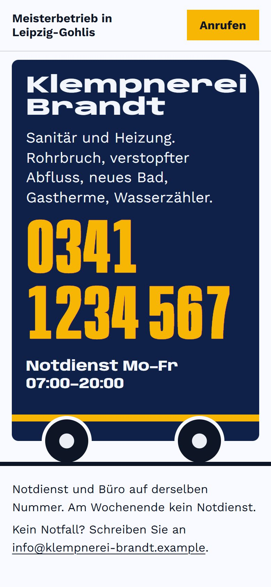
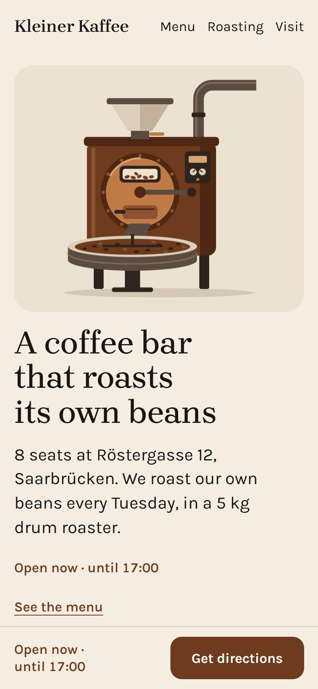

# Examples

Six sites, each from one run of the skill. The clients, people and numbers are made up. Each folder has the
answers, what the skill was told, the brief it wrote, the full source, and what was fixed by hand after the run.

The first two were made with 0.3. Fahrrad Hollerbach is a redesign: the skill read a made-up old site and rebuilt
it with 0.4's redesign tools. Kleiner Kaffee was made with 0.5, and Jonas Weber and Patch Night with 0.4, each by a
fresh agent. Four of them were made before 0.5's `look` check that the main action stays in view, and that check
reports them; the audit says Ready to ship on all six.

## [Klempnerei Brandt](klempnerei-brandt): a plumber, in German

**Answers:** A small business · Bold · Pick colours for me · No motion · Goal: call or message · No extras

Most people call with water on the floor, so the first screen is the side of the van, and the phone number lettered
on it is the button. An Impressum and a privacy page come with it, filled from the same facts.

| Desktop | Phone |
|---|---|
|  |  |

[Open the live site →](https://nikita-andreiev.com/one-shot-site/klempnerei-brandt/) · [See the run](https://nikita-andreiev.com/one-shot-site/#run-klempnerei-brandt)

## [Moth Orchestra](moth-orchestra): a band on tour

**Answers:** An event · Night · Brand colours from the album cover · Showpiece motion · Goal: get a ticket · Sound

The album is called *Lamp Hours*, so one bare bulb lights the page and the moth from the cover flies round it. The
eight nights below each have their own ticket link.

| Desktop | Phone |
|---|---|
|  |  |

[Open the live site →](https://nikita-andreiev.com/one-shot-site/moth-orchestra/) · [See the run](https://nikita-andreiev.com/one-shot-site/#run-moth-orchestra)

## [Fahrrad Hollerbach](fahrrad-hollerbach): a redesign

**Answers:** A redesign · Not sure, show me · Keep our green and yellow · Gentle motion · Goal: bring the bike in

A bike workshop's site from 2008, read page by page and rebuilt around the repair tag that hangs on every bike.
Every old page became a section; the old addresses forward to it.

| Before | After |
|---|---|
|  |  |

[Open the live site →](https://nikita-andreiev.com/one-shot-site/fahrrad-hollerbach/) · [See the run](https://nikita-andreiev.com/one-shot-site/#run-fahrrad-hollerbach)

## [Kleiner Kaffee](kleiner-kaffee): a café

**Answers:** A small business · Warm · Pick colours for me · Gentle motion · Goal: visit · No extras

No photos, so drawings carry it: their 5 kg drum roaster, drawn large beside the headline, in roast brown on
cream. On a phone the roaster comes first. The menu, a bag of their beans and the eight stools are drawn too.

| Desktop | Phone |
|---|---|
|  |  |

[Open the live site →](https://nikita-andreiev.com/one-shot-site/kleiner-kaffee/) · [See the run](https://nikita-andreiev.com/one-shot-site/#run-kleiner-kaffee)

## [Jonas Weber](jonas-weber): a developer's portfolio

**Answers:** Me and my work · Bold · Pick colours for me · Lively motion · Goal: hire me · Light and dark switch

Three apps that each do one job, so the first screen is their three names at poster size, each with its job and
its number. A light and a dark version, both checked.

| Desktop | Phone |
|---|---|
|  |  |

[Open the live site →](https://nikita-andreiev.com/one-shot-site/jonas-weber/) · [See the run](https://nikita-andreiev.com/one-shot-site/#run-jonas-weber)

## [Patch Night](patch-night): an event

**Answers:** An event · Night · Pick colours for me · Showpiece motion · Goal: get a ticket · Sound

A modular synth evening, so the first screen is a rack with one module per act. Drag a cable to patch an act in;
with Sound on, each patched module plays its own voice.

| Desktop | Phone |
|---|---|
|  |  |

[Open the live site →](https://nikita-andreiev.com/one-shot-site/patch-night/) · [See the run](https://nikita-andreiev.com/one-shot-site/#run-patch-night)

## Adding an example

1. Open a "New example or idea" issue with the client and the answers, and wait for an OK, so the gallery doesn't
   get two of the same.
2. Run the skill for a made-up client. Never a real business, person or account.
3. Copy the site folder to `examples/<name>/site`, without `node_modules`, `dist`, `tools` and
   `package-lock.json` (the project page installs without one). Keep `.one-shot/brief.md` and
   `.one-shot/allow.json`, and add `!.one-shot/brief.md` to the site's `.gitignore` so the brief stays in git.
4. Build it, then take the pictures: `node tools/showcase.mjs <name>=examples/<name>/site/dist` (list every example
   so `showcase.jpg` keeps all of them). Look at them: if a number reads 0 or an entrance is half way, add
   `--reduced <name>` for that site (Jonas Weber needs it).
5. Write `examples/<name>/README.md` in the same shape as the others: **Answers**, **What it was told**, **What it
   did with that**, the two pictures, **Checked with** (the version), **Fixed after the run**. The docs page reads
   these lines.
6. Add it to this page and to the table in the main README. Its pictures open the live site,
   `https://nikita-andreiev.com/one-shot-site/<name>/` (where `docs/build.mjs` puts it), with "Open the live
   site →" under them and "See the run", its window on the project page (`…/#run-<name>`). If the project page
   moves, that address is the one string to replace in `README.md` and `examples/`.