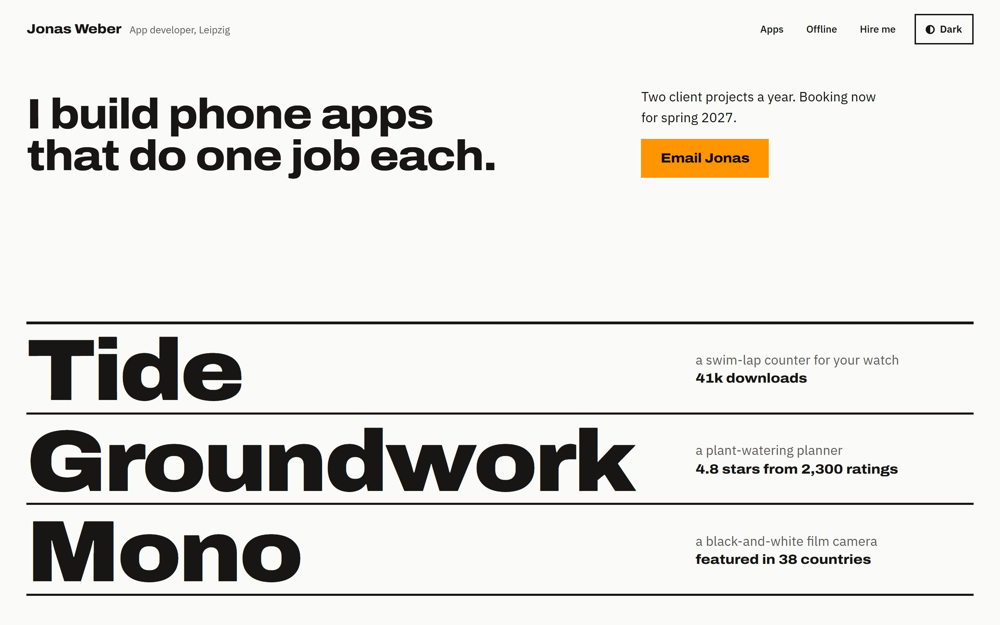
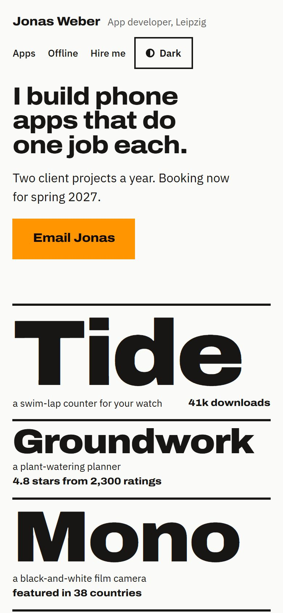

# Jonas Weber

A made-up independent app developer in Leipzig.

**Answers:** Me and my work · Bold · Pick colours for me · Lively motion · Goal: hire me · Light and dark switch

**What it was told:** independent app developer in Leipzig. Five years (2017–2022) on the offline downloads team of
a big music-streaming app, named in the material. Since then, his own small apps, each doing one job: Tide (a
swim-lap counter for a watch, 41k downloads, design award finalist 2024), Groundwork (a plant-watering planner, 4.8
stars from 2,300 ratings) and Mono (a black-and-white film camera, featured in 38 countries by a company the
material also named). Two client projects a year, booking spring 2027. No photos, no screenshots, no store links.

**What it did with that:** under one line, "I build phone apps that do one job each.", the first screen is the
three app names at poster size between thick rules, each with its job and its number. Below, each job is drawn: a
pool lane with tally marks, a watering week, a film strip. The offline years are one orange band, "Five years of
music with no signal.", in the orange of a phone's airplane-mode switch. Then a giant 2, for two client projects a
year, next to the email. Black and white with that one orange, in Archivo and IBM Plex Sans, with a light and a
dark version.

| Desktop | Phone |
|---|---|
|  |  |

[Open the live site →](https://nikita-andreiev.com/one-shot-site/jonas-weber/) · [See the run](https://nikita-andreiev.com/one-shot-site/#run-jonas-weber)

**Checked with 0.4:** in the run, lint, look, film and film with reduced motion found nothing, in light and in
dark. The audit, run again on the page as the project page publishes it: Ready to ship, all clear, on all three
pages, in light and in dark. The first visit is 180 KB. The audit is told to accept the made-up `.example` address
(`.one-shot/allow.json`, with the reason in the brief).

**Changed on review:** the run first used both real company names. On review it made them "a large music-streaming
app" and "featured in 38 countries" everywhere, so the example names no real company. Later the platform names went
too: "phone apps", "your watch", "your phone". With "phone" the headline ran to three lines at desktop width, so
from tablet width up it is no longer capped at 15 characters and splits into two even lines.

**Fixed after the run:** the privacy page names GitHub Pages as the host, where the project page puts the example.
With 0.5, the name keeps `translate="no"` in the header and the footer, so a translated page leaves it alone.
The light and dark button now names the theme it switches to (it always said Dark, even on a dark page), and its
half circle is drawn in SVG, so it stays whole when the page is zoomed.

Source: [site/](site). Run `npm install && npm run dev` inside it. The facts (apps, numbers, booking) live in
[site/site.json](site/site.json), and [site/EDITING.md](site/EDITING.md) is the owner's guide. Its `lint`, `look`
and `audit` scripts need the skill's tools in `tools/one-shot/`, which `new-site` copies in; they are left out here.
The brief the run wrote is in [site/.one-shot/brief.md](site/.one-shot/brief.md).
