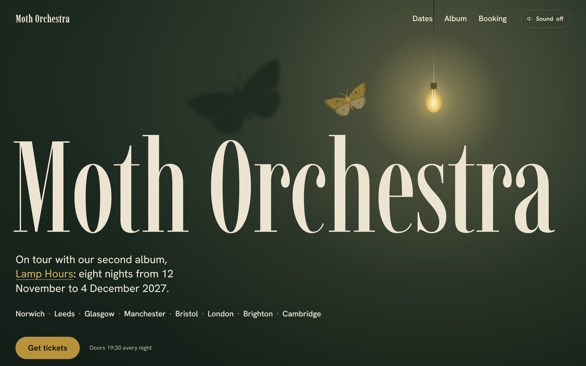
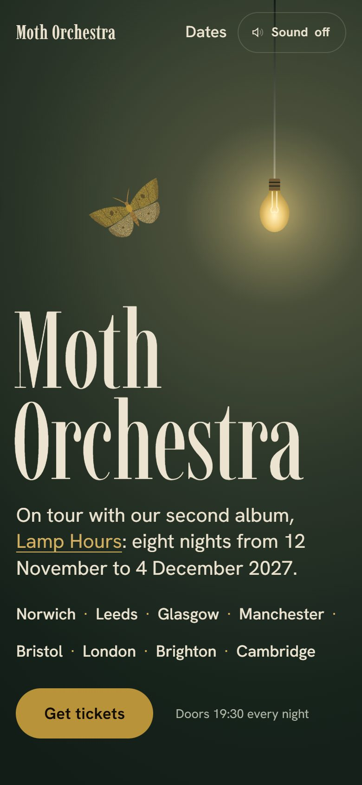

# Moth Orchestra

A made-up folk band from Norwich, on a winter tour.

**Answers:** An event · Night · Brand colours from the album cover · Showpiece motion · Goal: get a ticket · Sound

**What it was told:** a five-piece from Norwich: cello, banjo, two voices, drums. Second album *Lamp Hours*, out
6 November 2027, its cover an ochre moth on bottle green. Eight nights from 12 November to 4 December, doors 19:30,
tickets £14 (£16 in London). Every show ends with one unplugged song in the middle of the room.

**What it did with that:** it took the album title literally: a bottle-green room lit by one bare bulb. The ochre
moth from the cover circles it, bumps it so it swings, then lands; move the mouse or tap and it follows you, as if
you were the light. The last song is a drawn floor plan, the players walking off the stage into the crowd.

| Desktop | Phone |
|---|---|
|  |  |

[Open the live site →](https://nikita-andreiev.com/one-shot-site/moth-orchestra/) · [See the run](https://nikita-andreiev.com/one-shot-site/#run-moth-orchestra)

**Checked with v0.3:** in the run, lint, look, film and film with reduced motion found nothing. The audit, run
again on the page as the project page publishes it: Ready to ship, all clear. The first visit is 140 KB. The audit is told to accept the made-up `.example` addresses
(`.one-shot/allow.json`, with the reason in the brief).

**Fixed after the run:** the tour and the album moved a year on, to November 2027. The dates come from `site.json`,
and a night that has passed drops off the list, so the page would have lost its dates soon after launch. The eight
rooms are made up. On a wide screen the last song's two paragraphs now sit level with the middle of the floor plan
instead of at its top, so the left of the screen doesn't go empty beside it. Later the album page stopped naming a
music shop: the button says "Listen to Lamp Hours". And the big name in the footer lets clicks through: its tall
text box reached over the small print, so the top of the "Lamp Hours" link under it didn't take a click. With 0.5,
the name keeps `translate="no"` in the header, the footer and the h1, so a translated page leaves it alone. Two
font packages from the variants it didn't pick, Red Hat Display and Young Serif, are out of `package.json`; the
site never loaded them.

Source: [site/](site). Run `npm install && npm run dev` inside it. The nights, prices and ticket links live in
[site/site.json](site/site.json), and [site/EDITING.md](site/EDITING.md) says how to change them. Its `lint`, `look`
and `audit` scripts need the skill's tools in `tools/one-shot/`, which `new-site` copies in; they are left out here.
The brief the run wrote is in [site/.one-shot/brief.md](site/.one-shot/brief.md).
