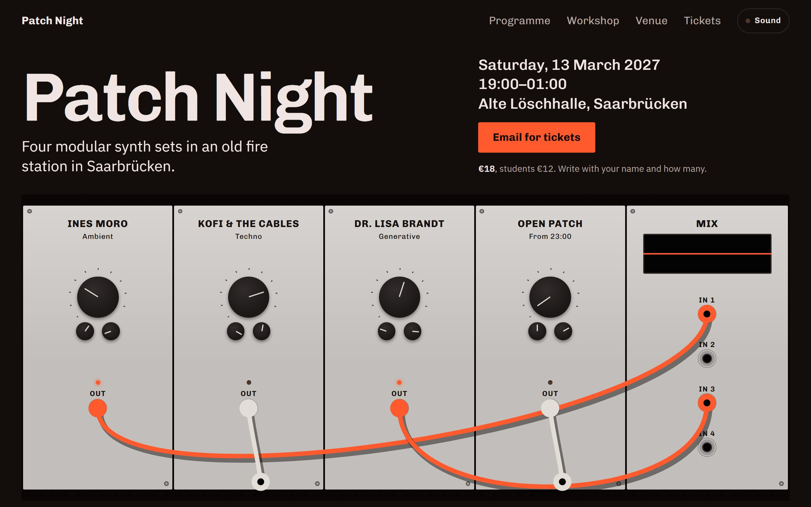
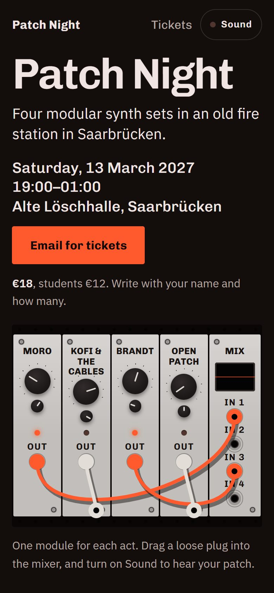

# Patch Night

A made-up modular synth evening in Saarbrücken.

**Answers:** An event · Night · Pick colours for me · Showpiece motion · Goal: get a ticket · Sound

**What it was told:** Patch Night, "Saturday 14 March 2027", 19:00–01:00, in the Alte Löschhalle, an old fire
station on Am Schlauchturm 4. Four sets: Ines Moro, Kofi & the Cables, Dr. Lisa Brandt, and Open Patch from 23:00,
when anyone can plug into the house rack. A workshop before the doors open, 16:00–18:00, 12 seats, +15 €. Tickets
18 €, students 12 €, by email. No legal pages: the collective adds its own. No photos.

**What it did with that:** the first screen is a drawn rack, one module per act plus a mixer. The cables drop into
place, and you can drag them with a mouse or a finger; a patched act lights up in the programme, and with Sound on,
each patched module plays its own voice and the mixer's screen draws it. Signal orange, from a hot patch cable and
a fire station's alarm lamp, on near-black, in Chivo and IBM Plex Sans. The page ends on "01:00, last cable out."

| Desktop | Phone |
|---|---|
|  |  |

[Open the live site →](https://nikita-andreiev.com/one-shot-site/patch-night/) · [See the run](https://nikita-andreiev.com/one-shot-site/#run-patch-night)

**What it caught:** 14 March 2027 is a Sunday. The run flagged it, and the night moved to Saturday 13 March.

**Checked with 0.4:** in the run, lint, look, film and film with reduced motion found nothing, and the headline is
readable after 0.66 s. The audit, run again on the page as the project page publishes it: Ready to ship, nothing
blocking. It lists the Impressum and the privacy page to consider, which the collective adds itself. The first
visit is 134 KB. The audit is told to accept the made-up `.example` address (`.one-shot/allow.json`, with the
reason in the brief).

**Not done:** the rack works with a mouse or a finger only, and screen readers skip it; keyboard users get the
programme and Sound, but can't re-patch. The voices were checked for errors and for a signal, not by ear: the
test browser runs muted.

**Fixed after the run:** with 0.5, the name keeps `translate="no"` in the header, the footer and the h1, so a
translated page leaves it alone.

Source: [site/](site). Run `npm install && npm run dev` inside it. The facts (date, programme, prices) live in
[site/site.json](site/site.json), and [site/EDITING.md](site/EDITING.md) is the owner's guide. Its `lint`, `look`
and `audit` scripts need the skill's tools in `tools/one-shot/`, which `new-site` copies in; they are left out here.
The brief the run wrote is in [site/.one-shot/brief.md](site/.one-shot/brief.md).
